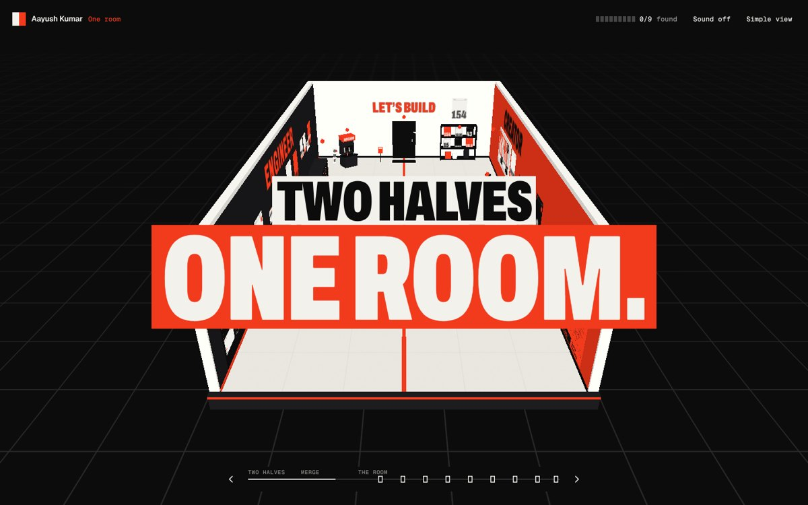

# portfolio

> Two halves scroll past each other, then fold into nine rooms.

**Live → [itsaayush2004.github.io/portfolio](https://itsaayush2004.github.io/portfolio/)** ·
the earlier walk-through lives on at [`classic.html`](classic.html).



This merges my two earlier portfolios, the walk-through gallery (this repo) and the
[corkboard](https://github.com/itsAayush2004/portfolio-board), into one page you only have to scroll.

## How it reads

| Act | What scrolling does |
|---|---|
| **I · Two halves** | Two lanes of real HTML run in opposite directions: **Engineer** on black, **Creator** on vermilion. The room shows through the seam between them. |
| **II · The merge** | The lanes swing open on their outer edges like doors and settle on the hall's side walls. *Two halves* and *Nine rooms* slide together, the camera lifts out over the building as a cut-away plan, and a red slash wipes it back inside. |
| **III · The rooms** | The camera walks doorway to doorway through nine rooms in a serpentine: black rooms for the engineer, red for the creator, white for both. Each room holds one piece, one poster and one label, and its card builds itself as you arrive. |

Stations: ARTHIS.space + ARTHIS.land · Blender add-on suite · HexaBed · AKverse · Systems & Inference ·
the Board (CV Forge and the side projects) · the Arcade (four playable games) · the numbers · contact.

Clicking is optional: arrows or `← →` step between stations, `1–9` jump, `E` opens the full write-up,
`M` opens the station list. Scrolling stops on the nearest station by itself.

## Design

- **Palette:** black `#0C0C0D`, paper `#F3F1EC`, vermilion `#F23A1D`. Nothing else.
- **Type:** Archivo at its condensed black width for poster type; Geist for text; Geist Mono for labels and data.
- **Pictures are set in type.** Every project's image, and every game's mark, is drawn in code (`POSTERS` in `app.js`): a cropped
  numeral, a halftone count, stacked words. The same definitions render as HTML in the lanes and as canvas
  textures on the room's walls. The only photo is the AKverse avatar on the channel screen.

## Motion

Every effect is tied to scroll, so it plays backwards too. Durations step by φ (160 · 260 · 420 · 680 ms)
on two curves: an out-curve for arrivals, an in-out curve for things that travel.

- The loader opens from the middle, like the two doors; letters rise out of masks.
- Each panel holds one frame, then glides to the next; the frame on show sits forward while the ones leaving
  and arriving recede, its type drifts at its own depth, and the counter rolls.
- At the merge the panels swing open (side doors on a desktop, a hatch and a trapdoor on a phone), the two
  words slide together, the camera lifts over the building, and a red slash wipes back inside.
- In each room the name rises up its wall as you come through the door, the piece settles on a small
  spring, and the caption builds itself. Sheets and dossiers glide in; buttons press.

`prefers-reduced-motion` turns all of it off.

## On a phone

The halves stack: Engineer above, Creator below, each the full width, with projects sliding sideways in
opposite directions. The caption becomes a bottom sheet with thumb-sized buttons, and the index a pull-up sheet.

## Proportion

φ = 1.618 runs through it: type steps 12 · 19 · 31 · 50 · 81 · 131, spacing steps 8 · 13 · 21 · 34 · 55 · 89,
posters and labels are golden rectangles, splits are 38.2 / 61.8, and each piece sits on the screen's golden line.
No scrollbars are drawn anywhere.

## How it works

- **One camera, two renderers.** The lanes are `CSS3DObject`s; the room is WebGL. Both draw from the same
  camera, so the HTML lanes become real walls. The WebGL canvas sits on top and cuts a transparent hole where each
  lane is, so anything standing in front of a lane still hides it.
- **The doors.** Each lane starts at exactly one screen-pixel per CSS pixel (its scale comes from the camera's
  field of view), and is hinged on its outer edge; scroll turns it 90° and scales it onto its wall.
- **Words live in the DOM.** Every word is in `#codex` as plain HTML. The station cards and the full write-ups are
  read from there, screen readers get one document, and the simple view shows it as a normal page.
- **Falls back cleanly.** No WebGL, or a click on *Simple view*, gives a flat two-column page with every word and
  link. `prefers-reduced-motion` drops the easing and ambient motion.

`index.html` (markup and content) · `style.css` · `app.js` · `vendor/` holds Three.js r128 and its CSS3DRenderer,
so nothing loads from a script CDN. No build step.

## Run locally

```bash
git clone https://github.com/itsAayush2004/portfolio.git
cd portfolio
python -m http.server 8000
```

Then open `http://localhost:8000`.

---

## About

**Aayush Kumar** — Game Developer · AI & Backend Engineer
B.Tech Electronics & Communication, NIT Jaipur (2026)

- [arthis.space](https://arthis.space) — browser mini-games platform
- [arthis.land](https://arthis.land) — procedural browser city
- [youtube.com/@AKverseOfficial](https://www.youtube.com/@AKverseOfficial)
- akversebusiness@gmail.com

---

## License

MIT — see [LICENSE](LICENSE).

The code is free to reuse. The written content, the posters in `art/`, the trailer and the personal
details are mine; please swap them for your own (the scenes in `art/src/poster.html` are a good
place to start).
